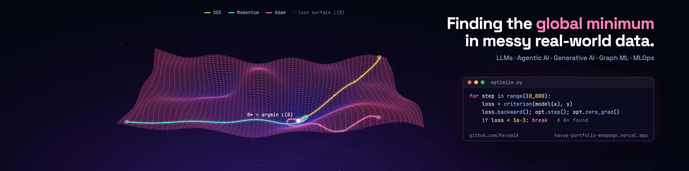

<div align="center">



<a href="https://kavya-portfolio-webpage.vercel.app"></a>

<a href="https://kavya-portfolio-webpage.vercel.app"></a>
<a href="https://www.linkedin.com/in/kavya-kalavala-6008b5286/"></a>
<a href="mailto:kxvya1820@gmail.com"></a>


</div>

---

### 👋 Hi, I'm Kavya

My favourite bug was in someone else's data. While building a brain-signal benchmark on a public EEG dataset, I found eight "different" participants whose recordings were **byte-for-byte identical**, so every model trained on it was quietly being tested on data it had already seen. I published an [audit tool](https://github.com/Kxvya18/cogbci-integrity-audit) so others can check their copies.

That is roughly how I work: build the system, then try hard to break it before anyone else does. I'm a B.Tech CSE (Data Science) student at **MIT Bengaluru** (2023–2027) working across **LLM agents, retrieval, graph machine learning, generative models, forecasting and MLOps**, and I like problems where mathematics, messy data and engineering meet.

```python
kavya = {
    "building":   ["agentic LLM systems with human sign-off", "production ML pipelines"],
    "researching": ["graph & temporal ML", "topology of brain networks", "uncertainty you can trust"],
    "published":  "MOGA-FCM @ CIMA 2026, NIT Puducherry",
    "rule":       "no claim without a baseline, a held-out test and a negative control",
}
```

---

### 🚀 Featured work

<table>
<tr>
<td width="50%" valign="top">

**[PalletCast](https://github.com/Kxvya18/palletcast-forecasting-mlops)** · *Forecasting & MLOps*<br/>
14-day warehouse pallet forecasting taken all the way to production on a simulated cold-storage network: data validation with quarantine, point-in-time features, a **17-model contest**, MLflow registry, Prefect, FastAPI, Evidently and CI/CD.<br/>
`10.8% WAPE` vs `14.6%` best rule of thumb

</td>
<td width="50%" valign="top">

**[DelegNet](https://github.com/Kxvya18/DelegNet)** · *Security ML*<br/>
Stops wallet drainers **before** you sign an EIP-7702 delegation. Built the first labelled real-world dataset (**637,846** authorizations) and tested on contract families never seen in training.<br/>
`0.984 recall` at `0.16%` false alarms under every evasion attack

</td>
</tr>
<tr>
<td valign="top">

**[PIRGE-CodeGuard](https://github.com/Kxvya18/pirge-codeguard)** · *Agent safety*<br/>
A seatbelt for AI coding agents: every proposed command becomes a provenance-checked warrant, risky actions are blocked or rewritten, and every decision lands in a hash-chained audit log.<br/>
`16/16` risky actions blocked · `7/7` safe ones executed

</td>
<td valign="top">

**[ClearDue](https://github.com/Kxvya18/cleardue)** · *Agentic AI*<br/>
LangGraph agents that investigate short payments, a separate verifier model that checks the reasoning, and deterministic safety gates before a human approves. Checkpointed, cited and replayable on PostgreSQL + pgvector.

</td>
</tr>
<tr>
<td valign="top">

**[Cross-task EEG workload decoding](https://github.com/Kxvya18/eeg-load-signature)** · *Brain AI*<br/>
A decoder that borrows structure from other people in a shared low-rank Riemannian space and adapts to a new task without labels, beating CORAL, Group-DRO and subject-specific baselines.<br/>
`0.75 / 0.90 AUC` on held-out subjects

</td>
<td valign="top">

**[INTERVENE](https://github.com/Kxvya18/intervene-luad-graph-attention)** · *Graph ML for biology*<br/>
Graph-sparse attention over biological modules for lung-cancer relapse, guided by pathway priors and checked across seeds, ablations and four external cohorts.<br/>
`C-index 0.76` vs `0.70` broader model · `0.50` shuffled control

</td>
</tr>
</table>

---

### 🧭 Everything I've built, by area

<details open>
<summary><b>🤖 LLMs, RAG & agentic AI</b></summary>

| Project | What it does |
|---|---|
| [pirge-codeguard](https://github.com/Kxvya18/pirge-codeguard) | Pre-execution safety gateway for coding agents |
| [cleardue](https://github.com/Kxvya18/cleardue) | LangGraph agents for B2B short-payment investigation, with a verifier model |
| [chaos-engineering](https://github.com/Kxvya18/chaos-engineering) | chaosctl: nine LangGraph agents run bounded, reversible chaos experiments with verified rollback |
| [enterprise-knowledge-copilot](https://github.com/Kxvya18/enterprise-knowledge-copilot) | Governed hybrid-RAG copilot on Azure AI Search with citations and groundedness checks |
| [revenueops-agent-control-tower](https://github.com/Kxvya18/revenueops-agent-control-tower) | Multi-agent CRM revenue-risk detection with human-review routing |
| [supportops-copilot](https://github.com/Kxvya18/supportops-copilot) | LLM issue triage that can only suggest; a person approves every action |
| [chnage-shield](https://github.com/Kxvya18/chnage-shield) | ChangeShield: self-repairing Playwright automations with human approval |
| [context-aware-rag-evaluation](https://github.com/Kxvya18/context-aware-rag-evaluation) | Dependency-free RAG harness: Hit@K, MRR, groundedness |
| [ai-gtm-lead-enrichment-automation](https://github.com/Kxvya18/ai-gtm-lead-enrichment-automation) | Lead scoring and LLM outreach prompts with CRM-ready payloads |

</details>

<details open>
<summary><b>📈 Forecasting, MLOps & reliability</b></summary>

| Project | What it does |
|---|---|
| [palletcast-forecasting-mlops](https://github.com/Kxvya18/palletcast-forecasting-mlops) | End-to-end MLOps for 14-day pallet forecasting |
| [carbon-twin-R](https://github.com/Kxvya18/carbon-twin-R) | Building-energy digital twin: sequential fault detection, conformal intervals, fault localisation |
| [model-calibration-diagnostics](https://github.com/Kxvya18/model-calibration-diagnostics) | ECE, Brier, reliability diagrams and temperature scaling under shift |
| [cross-domain-visual-robustness](https://github.com/Kxvya18/cross-domain-visual-robustness) | How classical models break from MNIST to SVHN |

</details>

<details>
<summary><b>🕸️ Graph ML, network science & applied mathematics</b></summary>

| Project | What it does |
|---|---|
| [transferguard-curvature-audited-localization](https://github.com/Kxvya18/transferguard-curvature-audited-localization) | Tracing attacks back to their source in evolving networks |
| [graph-spectral-early-warning](https://github.com/Kxvya18/graph-spectral-early-warning) | When does a network's spectrum warn of a tipping point? 15,200-setting identifiability study |
| [nwcf-eeg-topology](https://github.com/Kxvya18/nwcf-eeg-topology) | Clique filtration + persistent homology for brain networks, with stability proofs and an honest negative result |
| [degree-collision-reconstruction-bound](https://github.com/Kxvya18/degree-collision-reconstruction-bound) | Network archaeology: how much growth history a snapshot can reveal |
| [thermodynamic-pa-inference-single-snapshot](https://github.com/Kxvya18/thermodynamic-pa-inference-single-snapshot) | Inferring preferential-attachment parameters from one snapshot |
| [intervene-luad-graph-attention](https://github.com/Kxvya18/intervene-luad-graph-attention) | Graph-sparse attention for lung-cancer relapse |
| [qcertroute-quantum-expert-routing](https://github.com/Kxvya18/qcertroute-quantum-expert-routing) | Shot-adaptive quantum expert routing with certified top-ten decisions |

</details>

<details>
<summary><b>🔐 Security ML</b></summary>

| Project | What it does |
|---|---|
| [DelegNet](https://github.com/Kxvya18/DelegNet) | Pre-signature detection of malicious EIP-7702 delegations |
| [cost-aware-active-telemetry](https://github.com/Kxvya18/cost-aware-active-telemetry) | Finding the first compromised host when telemetry has a price (LANL) |

</details>

<details>
<summary><b>🧠 Brain, health & physiological AI</b></summary>

| Project | What it does |
|---|---|
| [eeg-load-signature](https://github.com/Kxvya18/eeg-load-signature) | Cross-task EEG mental-workload decoding |
| [cogbci-integrity-audit](https://github.com/Kxvya18/cogbci-integrity-audit) | Found 8 COG-BCI participant IDs with identical recordings |
| [hcp-meg-brain-state-pilot](https://github.com/Kxvya18/hcp-meg-brain-state-pilot) | MEG source-space pipeline and three pre-registered no-go probes |
| [moga-fcm-cognitive-load-detection](https://github.com/Kxvya18/moga-fcm-cognitive-load-detection) | Unsupervised driver cognitive-load detection (CIMA 2026) |
| [gluco-adapt-healthcare-ai](https://github.com/Kxvya18/gluco-adapt-healthcare-ai) | Risk-aware adaptive sensing for wearable glucose estimation |
| [hart-sampling-rate-adapters](https://github.com/Kxvya18/hart-sampling-rate-adapters) | Where to place adapters when a wearable sensor samples slower |

</details>

<details>
<summary><b>🎨 Generative models & Earth observation</b></summary>

| Project | What it does |
|---|---|
| [curvature-constrained-latent-diffusion](https://github.com/Kxvya18/curvature-constrained-latent-diffusion) | Latent diffusion that respects curvature and topology on real Kvasir-SEG masks |
| [Methane-twin-R](https://github.com/Kxvya18/Methane-twin-R) | Physics-informed detection and quantification of methane plumes from NASA EMIT |

</details>

---

### 📄 Publication

**MOGA-FCM: Unsupervised Cognitive Load Detection via Multi-Objective Genetic Algorithms and Bayesian Fuzzy C-Means in ADAS**<br/>
K. Kalavala, A. Pandey, S. Priya · *2nd Congress on Intelligent Machines and Algorithms (CIMA 2026), NIT Puducherry*

---

### 🛠️ Toolbox

<p align="center">
  
</p>

<p align="center">


</p>

---

### 📊 By the numbers

<p align="center">


</p>

<p align="center">
  
</p>

---

<div align="center">

**Open to AI/ML engineering roles and research collaborations.**<br/>
<sub>Every repository here has a README that says what worked, what didn't, and how to reproduce it.</sub>

</div>
